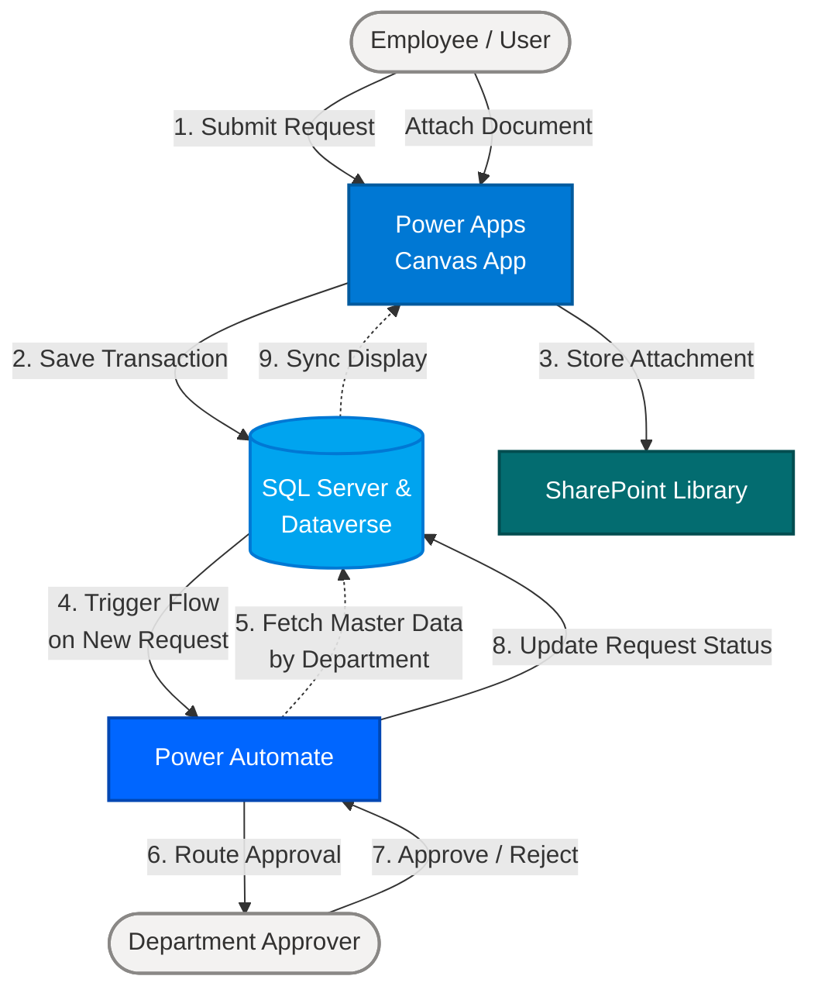

# Internal Service Apps

## Overview
**Internal Service Apps** adalah sebuah aplikasi internal berbasis **Canvas App** yang dikembangkan menggunakan ekosistem Microsoft Power Platform. Aplikasi ini dirancang untuk memfasilitasi dan mengotomatisasi berbagai pengajuan layanan internal perusahaan dari Employee/User kepada departemen terkait secara terpusat, sistematis, dan terintegrasi.

## Key Features
- **Centralized Canvas App**: Satu antarmuka aplikasi untuk berbagai jenis pengajuan layanan internal.
- **Dynamic Approval Routing**: Rute persetujuan (*approval*) yang otomatis menyesuaikan dengan departemen masing-masing pemohon berdasarkan pemetaan master data.
- **Integrated Document Management**: Penyimpanan dan pengelolaan dokumen pendukung secara aman melalui SharePoint.
- **Automated Workflow**: Pemanfaatan Power Automate untuk memastikan notifikasi dan proses *approval* berjalan tanpa intervensi manual.

## Application Modules
Aplikasi ini melayani tiga proses bisnis utama melalui modul-modul berikut:

1. **Cash Advance**
   Modul ini digunakan oleh Employee/User untuk mengajukan permohonan uang muka (*cash advance*) guna mendukung kegiatan operasional atau kebutuhan bisnis perusahaan.
2. **Monthly Expense Voucher**
   Modul ini dirancang untuk memfasilitasi pengajuan klaim pengeluaran bulanan yang telah dilakukan oleh karyawan berdasarkan kebijakan perusahaan.
3. **Internal Free Product**
   Modul ini memungkinkan karyawan untuk mengajukan permohonan pengambilan atau penggunaan produk internal secara gratis sesuai dengan alokasi atau hak yang telah ditentukan.

## Technology Stack
Aplikasi ini memanfaatkan berbagai teknologi dari Microsoft untuk menjamin keandalan, keamanan, dan kemudahan pemeliharaan. Berikut adalah rincian tumpukan teknologi (*technology stack*) yang digunakan:

| Teknologi | Kategori | Peran & Fungsi dalam Sistem |
| :--- | :--- | :--- |
| **Power Apps** | Front-End / UI | Platform utama pengembangan **Canvas App** yang digunakan sebagai antarmuka (*user interface*) bagi Employee/User untuk berinteraksi dengan modul aplikasi. |
| **Microsoft SQL Server** | Database | Digunakan sebagai basis data relasional utama untuk menyimpan data transaksional yang kompleks. |
| **Microsoft Dataverse** | Database | Berperan sebagai sistem manajemen basis data untuk mengelola entitas bisnis standar dan pemetaan *master data*. |
| **SharePoint Library** | File Storage | Digunakan sebagai repositori penyimpanan dokumen pendukung (lampiran/ *attachments*) yang diunggah oleh pengguna saat melakukan pengajuan. |
| **Power Automate** | Workflow Engine | Menjalankan *Cloud Flows* untuk mengotomatisasi proses pengiriman notifikasi dan mengelola *approval workflow* ke pihak yang berwenang. |

## Integrations
Sistem ini sangat bergantung pada integrasi mulus antara komponen Power Platform dan Microsoft 365:
- **Canvas App to Database**: Aplikasi membaca dan menulis data transaksi secara *real-time* ke SQL Server dan Dataverse menggunakan konektor standar/premium.
- **Canvas App to SharePoint**: Dokumen yang diunggah oleh pengguna dikirim secara langsung ke dalam hierarki folder yang terstruktur di SharePoint Library.
- **Power Automate to Dataverse/SQL**: Alur persetujuan dipicu (*triggered*) ketika ada *record* baru atau pembaruan status di dalam *database*.

## System Workflow & Approval Process
Proses kerja sistem dan persetujuan didesain agar transparan dan akurat sesuai dengan struktur organisasi perusahaan. 

1. **Submission**: Employee/User membuat *request* melalui salah satu modul di Canvas App dan mengunggah dokumen pendukung jika diperlukan.
2. **Data Evaluation**: Sistem akan menyimpan *record* ke dalam basis data dan mencocokkan profil pemohon dengan master data departemen (Department) yang tersimpan di Dataverse/SQL Server.
3. **Automated Routing**: Power Automate membaca master data departemen tersebut untuk menentukan rute persetujuan (pihak Approver) yang relevan.
4. **Approval Task**: Approver yang bertugas (sesuai departemen pemohon) akan menerima tugas persetujuan dan dapat memberikan keputusan (Approve/Reject).
5. **Status Update**: Setelah keputusan diambil, Power Automate akan memperbarui status *request* di dalam basis data, dan pengguna akan melihat pembaruan status tersebut di Canvas App.

### Architecture & Workflow Diagram

---
*Dokumentasi ini dikelola sebagai bagian dari panduan teknis Internal Service Apps.*